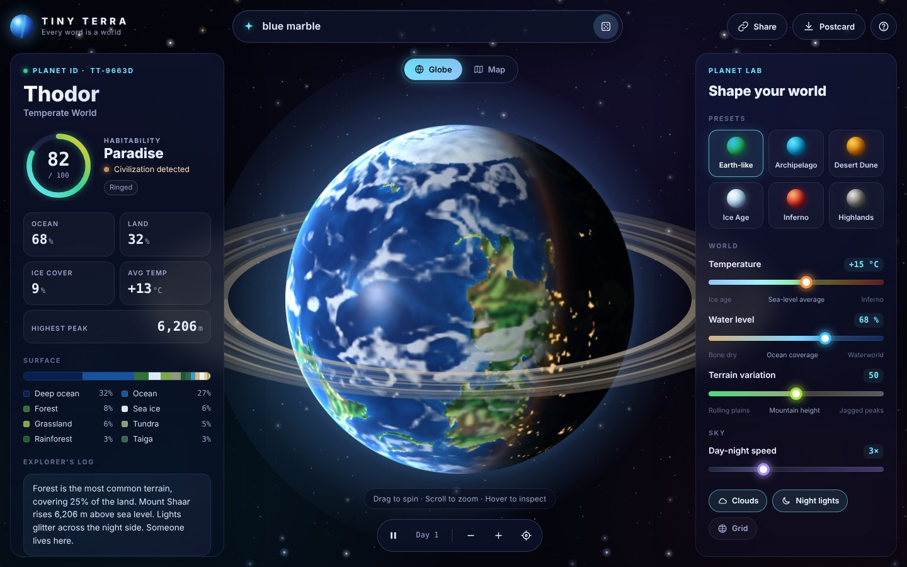

# Tiny Terra

**Every word is a world.** Type any word and Tiny Terra grows a miniature planet from it: oceans, continents, mountains, forests, deserts, ice caps, drifting clouds, a day-night cycle with city lights, and sometimes rings. The same word always builds the same planet.



Built for **The Exchange**, Track IV: *Living Worlds & Simulations*, problem statement **Tiny Terra**.

## Run it

1. Open `index.html` in any modern browser by double-clicking it.

There is nothing to install, no build step, no server, no API key and no network access. It works offline from `file://`.

To run the self-checks, open `tests.html`, or run `node js/tests.js` from a terminal.

## What the problem statement asked for, and where it is

| Requirement | How Tiny Terra does it |
| --- | --- |
| Oceans, mountains, forests, deserts and snowy regions placed by generation rules | 16 biomes from elevation, temperature and moisture: deep ocean, ocean, shallow sea, sea ice, beach, desert, savanna, grassland, forest, rainforest, taiga, tundra, snowfield, glacier, mountains and scorched rock |
| Generate new planets from random seeds | 🎲 button or `R` picks a memorable random seed such as `amber-harbor-42` |
| Custom seeds, and the same seed always gives the same planet | Any text works, including emoji and other scripts. Generation is fully deterministic and never uses `Math.random` (this is tested) |
| Explore through a 2D map or a rotating globe | **Both.** A shaded 3D globe (drag, zoom, inertia) and an equirectangular map (drag to pan), switched with `M` |
| Day-and-night cycle with moving sunlight | The planet rotates under a fixed sun: soft terminator, orange twilight band, sun glint on the oceans, and city lights or lava glow on the night side. Speed slider and pause |
| Temperature, water level and terrain variation settings | Three live sliders that recolour the planet instantly. Water level equals ocean coverage exactly (±1.5%, tested) |
| Hot planets get large deserts, cold planets get snow and ice | Built into the climate rules and checked by the tests |
| Every planet feels different | Seed-driven continent size, coastline warp, mountain ranges, ocean tint, occasional exotic flora (violet, crimson, teal, gold) and planetary rings |

## Beyond the brief

- **Planet ID card.** A generated name and catalogue number, a world class (Ocean World, Desert World, Ice World and so on), a habitability score out of 100, ocean, land and ice coverage, average temperature, highest peak, a surface breakdown and an explorer's log written from the planet's own statistics.
- **Point inspector.** Hover over the globe or map (tap on touch screens) to see the biome, elevation or depth, temperature, local time of day and coordinates.
- **Six climate presets** (Earth-like, Archipelago, Desert Dune, Ice Age, Inferno, Highlands). They animate the sliders so you can watch the planet transform.
- **Share links.** The URL always holds the seed and settings, so a copied link reopens the exact planet. Tampered links are cleaned up safely.
- **Postcard export.** Saves a 1600×900 PNG of the planet with its ID card.
- **Layers.** Clouds, night lights and a latitude and longitude grid.
- **Built to feel smooth.** Planet building is split across frames so the page never freezes, and globe resolution adapts to the speed of the machine.
- **Works on phones and tablets.** Responsive layout, pinch zoom and tap to inspect.
- **Keyboard and accessibility.** Full keyboard control, labelled controls, visible focus, a screen-reader summary of the planet, and reduced-motion support.

## Controls

| Action | Mouse or touch | Keyboard |
| --- | --- | --- |
| Spin the globe | Drag | Arrow keys |
| Zoom | Scroll or pinch | `+` and `−`, `0` resets |
| Inspect a spot | Hover or tap | — |
| New random planet | 🎲 | `R` |
| Type a seed | Seed box | `/` |
| Globe or map | Toggle at the top | `M` |
| Pause day and night | ⏸ | `Space` |
| Clouds, lights, grid | Layer buttons | `C`, `L`, `G` |
| Climate presets | Preset tiles | `1` to `6` |
| Share link, postcard | Top-right buttons | `S`, `P` |
| Help | `?` button | `?` |

## How it works

1. **Seed.** The text is cleaned up (trimmed, Unicode-normalised, capped at 200 characters), then hashed with FNV-1a and a murmur finaliser into a 32-bit number. That number seeds a small PRNG (mulberry32), which shuffles the permutation tables for 3D simplex noise.
2. **Fields on a sphere.** Every point is sampled in 3D on the unit sphere, so there are no seams at the date line and no pinching at the poles. The engine computes:
   - continents: domain-warped fractal noise plus a very low-frequency swell that groups land into continents
   - ridged mountain ranges, mostly on continental crust
   - moisture and temperature variation
   - city clusters
   - a separate, swirled cloud layer
3. **Climate (instant on every slider move).**
   - The **water level** becomes a sea level through an area-weighted histogram of heights, which is why the slider equals ocean coverage exactly.
   - **Temperature** = slider + latitude curve (it averages to zero over the sphere) − 6.5 °C per km of altitude.
   - **Moisture** follows Earth-like wet and dry bands, plus noise. Hot worlds dry out.
   - Each point becomes a biome. Colours get hillshading and gentle blending.
4. **Rendering.** A per-pixel shader written in plain JavaScript draws the globe. It handles:
   - smooth sub-texel coastlines
   - soft day-night lighting with a twilight band
   - ocean glint, night lights, clouds and atmospheric scattering at the limb
   - rings drawn behind and in front of the planet

The globe rotates under a fixed sun, so the day-night cycle is real rotation rather than a moving overlay.

## Quality checks

`tests.html` runs 25 checks on the real engine in your browser. `node js/tests.js` runs the same checks in a terminal.

- **Determinism.** The same seed gives an identical planet. `Math.random` is never called. A chunked build equals a one-shot build. Reused buffers never leak old data.
- **Seeds.** Blank text, emoji, 10,000-character strings, `<script>` tags, SQL-like text, control characters, lone surrogates, right-to-left scripts and `__proto__` all produce valid planets.
- **Sliders.** Every extreme and combination gives finite numbers and valid colours. Ocean coverage matches the slider. Hot worlds have more desert and cold worlds more ice. Temperature rises steadily with the slider.
- **Share links.** Links round-trip exactly. Malformed, oversized, duplicated or script-like parameters are clamped or ignored. There is no prototype pollution.
- **Speed.** A full planet builds in about 0.2 s and recolours in about 10 ms on a laptop.

All user text is written with `textContent`, never as HTML.

## Project structure

```
index.html      App markup
css/style.css   All styling (no external fonts or assets)
js/terra.js     Planet engine: pure, deterministic, no DOM (also loads in Node)
js/app.js       Rendering, interaction and UI
js/tests.js     Self-check suite (browser and Node)
tests.html      Self-check page
docs/           README image
```

## Known limits

- Share links opened from `file://` only work on the same computer. Host the folder anywhere static, such as GitHub Pages, to share them widely.
- The surface texture is 512×256, so the closest zoom looks soft. This keeps slider changes instant on modest laptops.
- There is no axial tilt or seasons. The sun sits slightly north of the equator all year.
